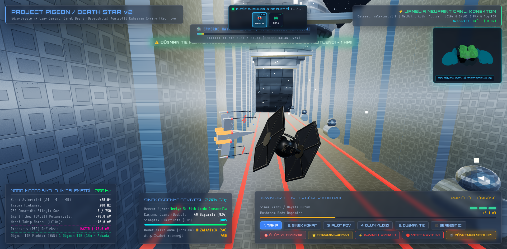
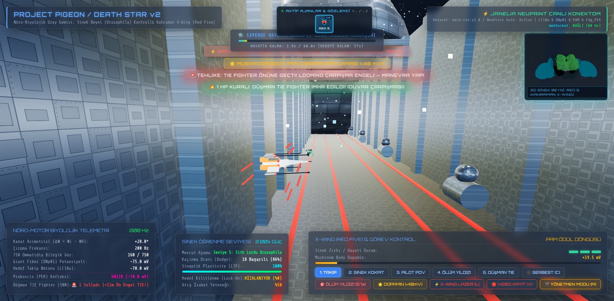
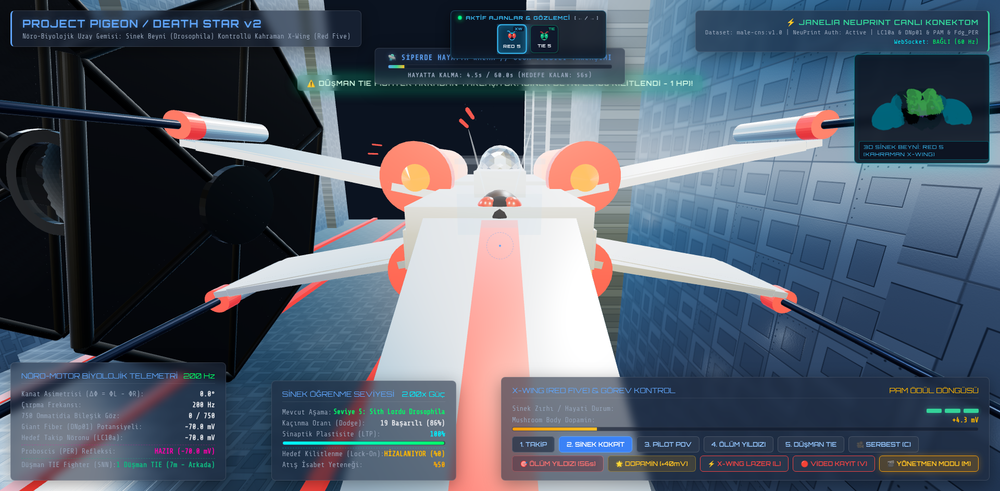
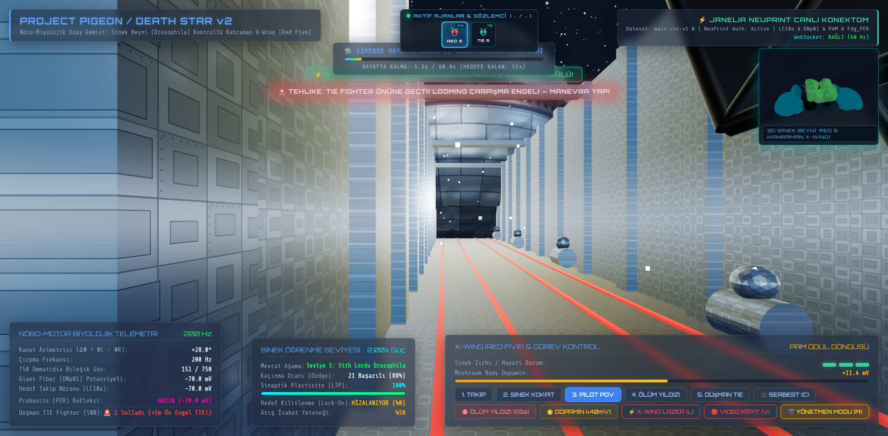
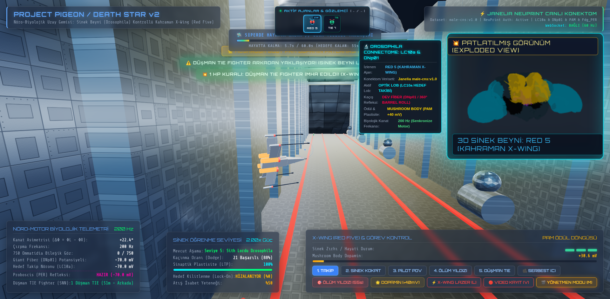

# Death Star v2: Drosophila SNN Flight Control & Neural Trench Run

[EN] An interactive 3D Star Wars Death Star trench run simulation based on the biological vision system and brain connectome of Drosophila melanogaster (fruit fly) (Janelia male-cns:v1.0), powered by a 750-ommatidia compound eye architecture and a Spiking Neural Network (SNN).

[TR] Drosophila melanogaster (meyve sineği) biyolojik görme sistemi ve beyin konektomunu (Janelia male-cns:v1.0) referans alan; 750 ommatidia bileşik göz mimarisi ve Spiking Neural Network (SNN) ile çalışan interaktif 3D Star Wars Death Star siper uçuş simülasyonu.

---

## 📸 Simulation Showcase | Simülasyon Galerisi

<!-- Hero Banner: Imperial TIE Fighter Chase -->

  
   
  <em><b>[EN]</b> Imperial TIE Fighter in hot pursuit down the Death Star trench. 
  <b>[TR]</b> Ölüm Yıldızı siperinde X-Wing'i kovalayan İmparatorluk TIE Fighter'ı.</em>

<table>
  <tr>
    <td width="50%">
      
      

        <b>[EN] Trench Dogfight & Real-Time SNN Telemetry</b> 
        <b>[TR] Siper İçi İt Dalaşı & Canlı SNN Telemetrisi</b>
      

    </td>
    <td width="50%">
      
      

        <b>[EN] Drosophila Melanogaster Bio-Pilot in Cockpit</b> 
        <b>[TR] Kokpitteki Drosophila Melanogaster Biyo-Pilotu</b>
      

    </td>
  </tr>
  <tr>
    <td width="50%">
      
      

        <b>[EN] Fly Pilot POV (750 Ommatidia Compound Eye)</b> 
        <b>[TR] Sinek Pilotun Gözünden Görüş (750 Ommatidia)</b>
      

    </td>
    <td width="50%">
      
      

        <b>[EN] 3D Connectome Exploded View (Iron Man Mode)</b> 
        <b>[TR] 3D Konektom Patlatılmış Görünüm (Mekanik Söküm)</b>
      

    </td>
  </tr>
</table>

---

🌟 Features | Özellikler

[EN]

750 Ommatidia Compound Eye Model: 3D spherical gaze vectors and retinotopic optical flow detection with 375 ommatidia each in the left and right hemispheres.

Janelia male-cns:v1.0 Biological SNN Circuit:

LC10a (Lobula Columnar - Small target tracking)

DNp01 (Descending neurons - Wing beat and flight steering control)

PAM (Reward/Dopaminergic neurons)

Fdg_PER (Target lock & torpedo firing feedback)

Leaky Integrate-and-Fire (LIF) membrane dynamics and synaptic delays.

Three.js Web-Based 3D Interface: Death Star, TIE Fighter / Biological fighter, trench architecture, exhaust port, neural hologram visualization, and proton torpedoes.

Real-Time WebSocket Communication: Bidirectional telemetry stream between the Python neural engine and the browser via FastAPI and WebSockets.

[TR]

750 Ommatidia Bileşik Göz Modeli: Sol ve sağ yarıkürelerde 375'er ommatidium ile 3D küresel bakış vektörleri ve retinotopik optik akış (optical flow) algılama.

Janelia male-cns:v1.0 Biyolojik SNN Devresi:

LC10a (Lobula Columnar - Küçük hedef takibi)

DNp01 (İniş nöronları - Kanat çırpma ve uçuş yönlendirme kontrolü)

PAM (Ödül/Dopaminerjik nöronlar)

Fdg_PER (Hedef kilitlenme & torpido ateşleme geri bildirimi)

Leaky Integrate-and-Fire (LIF) membran dinamikleri ve sinaptik gecikmeler.

Three.js Web Tabanlı 3D Arayüz: Death Star, TIE Fighter / Biyolojik avcı, siper mimarisi, egzoz portu, nöral hologram görselleştirmesi ve proton torpidoları.

Gerçek Zamanlı WebSocket İletişimi: FastAPI ve WebSocket ile Python nöral motoru ile tarayıcı arasında çift yönlü telemetri akışı.

🚀 Installation | Kurulum

1. Clone the Repository | Depoyu Klonlayın

git clone https://github.com/bilalefekilic34/deathstar.git
cd deathstar

2. Create a Virtual Environment & Install Dependencies | Sanal Ortam Oluşturun ve Bağımlılıkları Yükleyin

[EN]

python3 -m venv venv
source venv/bin/activate  # For Windows: venv\Scripts\activate
pip install -r requirements.txt

[TR]

python3 -m venv venv
source venv/bin/activate  # Windows için: venv\Scripts\activate
pip install -r requirements.txt

🔑 Janelia Neuprint API Configuration (Optional) | Janelia Neuprint API Yapılandırması (Opsiyonel)

[EN]
The system can run with both the local Janelia connectome reference model and directly with the Janelia Neuprint live API.

Obtain an authentication token from Janelia Neuprint.

Open the api.py file and enter your API key:

YOUR_API_KEY = "ENTER_YOUR_TOKEN_HERE"

(Alternatively, you can define the NEUPRINT_APPLICATION_CREDENTIALS environment variable).

[TR]
Sistem hem yerel Janelia konektom referans modeliyle hem de doğrudan Janelia Neuprint canlı API'siyle çalışabilir.

Janelia Neuprint üzerinden bir kimlik doğrulama belirteci (token) edinin.

api.py dosyasını açıp API anahtarınızı girin:

YOUR_API_KEY = "BURAYA_TOKENINIZI_YAZIN"

(Alternatif olarak NEUPRINT_APPLICATION_CREDENTIALS ortam değişkenini de tanımlayabilirsiniz).

🎮 Running | Çalıştırma

[EN] Start the server:
[TR] Sunucuyu başlatın:

python3 server.py

[EN] Then open in your browser:
[TR] Ardından tarayıcınızda açın:

http://localhost:8000

📁 Project Structure | Proje Yapısı

deathstarv2/
├── server.py                 # FastAPI & WebSocket server / sunucusu
├── snn_ommatidia_engine.py   # 750 Ommatidia & Biological SNN engine / Biyolojik SNN motoru
├── requirements.txt          # Python dependencies / bağımlılıkları
├── api.py           # API configuration template / API yapılandırma şablonu
├── models/                   # 3D GLB models and textures / 3D GLB modelleri ve dokuları
│   ├── death_star.glb
│   ├── tie_fighter.glb
│   ├── exhaust_port.glb
│   └── trench_module.glb
├── screenshots/              # Simulation showcase images / Simülasyon ekran görüntüleri
└── web/                      # Three.js 3D client interface / istemci arayüzü
    ├── index.html
    ├── css/
    └── js/

🔗 References | Referanslar

Trilogy Group: SpaceWars (GitHub)

Sketchfab: TIE Fighter Models

Sketchfab: Death Star Models
